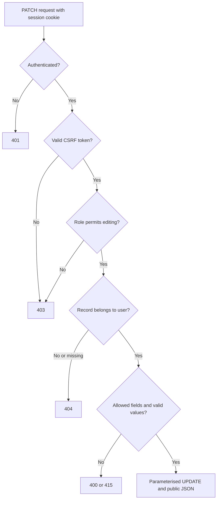

# Exercise 1: Build a protected JSON API

**Block 1 · 40 minutes · individual, highly guided**

Your starter has working login, web pages, role helpers and SQLite operations. Two API routes deliberately return `501` until you implement them. You can start here without Activity 1. Aim to explain each control as well as making the tests pass.

**Suggested time:** setup/read 5 min, GET 10 min, PATCH and validation 20 min, evidence 5 min. If you need more time, finish the remaining tests during independent catch-up.

## Setup and first run

1. Accept the lecturer's classroom50 assignment and open **your** repository in a GitHub Codespace. Wait for the container setup to finish. It creates the root `.venv` and installs the pinned dependencies.
2. In VS Code's Explorer, right-click **this exercise's folder** and choose **Open in Integrated Terminal**. This avoids accidentally running a different `app.py`.
3. Check the interpreter and install the local dependency list if setup was interrupted:

   ```bash
   python --version
   python -m pip install -r requirements.txt
   ```

   The version must begin `Python 3.14`. If it does not, rebuild the supplied container and select the repository's `.venv/bin/python` interpreter. Do not silently continue on a different Python version.
4. Run the browser application:

   ```bash
   python app.py
   ```

5. Open the forwarded port **5000** from the Ports panel. Confirm its visibility is **Private**. Sign in using the account table below. The browser URL ends with `.app.github.dev` in Codespaces.
6. Use a second terminal in this same exercise folder for tests and API examples. Stop the server with **Ctrl+C** before changing exercises. Because the reloader is disabled, stop and restart after editing Python code.

The API probe does **not** need the browser server. Every `python lab_client.py ...` command starts with a fresh temporary database. Repeated requests within one `--repeat` command share one application and rate-limit budget. A separate command resets them. Browser requests use the separate persistent `instance/notes.sqlite` database.

Reset the browser data only when needed (this removes this exercise's local note edits):

```bash
python -m flask --app app:create_app reset-db
```

For local use outside Codespaces, install Python 3.14, create a virtual environment with `python3.14 -m venv .venv`, activate it (`source .venv/bin/activate` on Linux/macOS, `.venv\Scripts\Activate.ps1` on PowerShell), and install `requirements.txt`. Open `http://127.0.0.1:5000`. Each exercise can run on its own with its own supplied requirements.

## Scenario and policy

Private Notes is a small internal planning application. A Jinja web page and a JSON API access the same SQLite records. The two interfaces must implement the same policy.

| Username | Role | Own note | Read own note | Edit own note | Access another owner's note |
|---|---|---:|---|---|---|
| `reader` | `viewer` | 1 | Yes | No | No |
| `editor` | `editor` | 2 | Yes | Yes | No |
| `other_editor` | `editor` | 3 | Yes | Yes | No |
| `admin` | `admin` | 4 | Yes | Yes | No |

All four fictional accounts use `Classroom-Only-314!`. Do not reuse this password elsewhere. Unknown roles receive no permission. In this deliberately narrow policy, **admin does not override ownership**. No interface permits changing `owner_id` or `is_reviewed`. A role permission answers “may this user perform this operation?” Ownership answers “on this record?”

Roles are reloaded from the database for each request. Client JSON cannot assign a role. The session cookie holds the user ID and CSRF token and is signed, not encrypted. It must not contain a password or private note.

## How the supplied application works

| File or folder | Purpose | How to read it |
|---|---|---|
| `app.py` | Configuration, web routes, API routes, error handlers | Read `create_app()` from top to bottom. A factory is just a function that builds and returns an application. |
| `db.py` | SQLite schema, seed data and query functions | `find_note(id)` returns a row or `None`. `update_note` changes only title/content using SQL placeholders. |
| `security.py` | Role, ownership, CSRF and validation helpers | Functions return a Boolean, return validated data, or stop the request with `abort`. |
| `templates/` | Login and notes pages | Jinja inserts values with `{{ ... }}` and controls loops/conditions with ``. HTML text is escaped automatically. |
| `static/style.css` | Small stylesheet | Kept outside the HTML so the supplied CSP permits it. No JavaScript is required. |
| `lab_client.py` | Repeatable HTTP examples without a running server | Logs in through the real login route and supplies the resulting CSRF token. |
| `tests/` | Checks using Flask's test client | Each test uses a fresh temporary database. Tests never change browser data. |
| `instance/` | Browser application's generated database | Created when you run the app. Ignored by Git. |

`@app.get(...)` registers the function beneath it as a route. `<int:note_id>` converts a URL segment to an integer argument. `g.user` is the user loaded for this request. `session` persists small signed values across requests. `jsonify` creates a JSON response with the correct content type. `return response, 403` sets an HTTP status; returning an error message alone can accidentally send `200`.

A SQLite row supports `note["title"]` like a dictionary, but is not itself a JSON response. `public_note` deliberately selects the response fields. The `?` in SQL is a value placeholder: the SQLite driver binds supplied values instead of constructing SQL by concatenation.

## 1. Understand the endpoint contract

REST-style routes represent resources. This lesson uses `GET` to retrieve one note and `PATCH` for a partial update. JSON is a data format; returning JSON does not confer security. A Python dictionary becomes a JSON object, but the application still chooses which fields leave the server.

| Request | Intended result |
|---|---|
| Authenticated owner GET `/api/notes/2` as editor | `200`, with `id`, `title`, `content` only |
| No session | `401` JSON error, not an HTML login redirect |
| Viewer PATCH own note | `403` |
| Editor GET/PATCH another owner's or missing note | `404` |
| Invalid/empty JSON object, unexpected field or invalid value | `400` |
| PATCH without a JSON content type | `415` |

The API is session-authenticated, just like the web interface. Cookies can accompany an unwanted browser request, so PATCH also needs the supplied CSRF token. This is not a bearer-token/JWT implementation. CORS is neither a permission check nor a replacement for CSRF protection.

## 2. Implement GET

Open `app.py`. Locate `TODO GET`. Replace the entire route (decorator and function) with the following, keeping it inside `create_app` with four spaces before the decorator/`def` and eight before each body line.

```python
@app.get("/api/notes/<int:note_id>")
def get_note_api(note_id):
    user = require_user()
    if not can_read_notes(user):
        abort(403)
    note = find_note(note_id)
    if not owns_note(user, note):
        abort(404)
    return jsonify(public_note(note))
```

Read the route in order:

1. `require_user()` returns the authenticated database user or stops with `401`.
2. `can_read_notes` implements the allowed roles. Unknown roles fail closed.
3. `find_note` retrieves one row. `owns_note` handles both `None` and another owner; neither case reaches the response.
4. `public_note` selects response fields. Returning `dict(note)` would expose protected internal properties.
5. `jsonify` serialises the selected data and sets `application/json`. With no explicit error status it returns `200`.

Run:

```bash
python lab_client.py
python lab_client.py --user anonymous
python lab_client.py --path /api/notes/3
python -m pytest -q tests/test_api.py -k get_
```

**Checkpoint:** `200`, `401`, `404` respectively. The GET tests pass. PATCH tests remain unfinished.

## 3. Trace validation before writing PATCH

Open `security.py` and read `read_json_object` and `validate_changes`.

- `request.is_json` checks the content type. `request.get_json()` parses JSON; malformed syntax raises a `400` error.
- `isinstance(data, dict)` rejects arrays, strings, numbers and `null`. `not data` rejects an empty object.
- `set(data)` produces the dictionary's keys. `set(data) - allowed_fields` finds keys that the API did not permit. Rejecting them prevents mass assignment.
- `.items()` produces each `(field, value)` pair. Values must be strings. The title must contain non-whitespace text and have at most 80 characters; content may be empty but must not exceed 2,000 characters.
- The whole request must pass validation before any UPDATE. A mixed body containing a valid title and protected field must leave the database unchanged.

Predict: will `{"title": false}`, `[]`, `null`, and `{"owner_id": 3}` pass? Explain which check rejects each. Python's `bool` is not a valid title even though it behaves like an integer in some expressions.

## 4. Implement PATCH

Replace the `TODO PATCH` route with:

```python
@app.patch("/api/notes/<int:note_id>")
def patch_note_api(note_id):
    user = require_user()
    check_csrf()
    if not can_edit_notes(user):
        abort(403)
    note = find_note(note_id)
    if not owns_note(user, note):
        abort(404)
    data = validate_changes(read_json_object())
    # PATCH can change just one field. Missing fields retain their value.
    title = data.get("title", note["title"])
    content = data.get("content", note["content"])
    update_note(note_id, user["id"], title, content)
    return jsonify(public_note(find_note(note_id)))
```

`data.get("title", note["title"])` means “use the supplied title if present, otherwise keep the stored title”. This is why PATCH can change content alone. `update_note` uses a fixed SQL statement with bound values and an owner condition. It cannot update `owner_id` or `is_reviewed`. The response reads the updated row back.

Run:

```bash
python lab_client.py --method PATCH --json '{"title":"Updated plan"}' --inspect 2
python lab_client.py --method PATCH --json '{"content":"Updated content only"}'
python lab_client.py --method PATCH --json '{"owner_id":3}' --inspect 2
python lab_client.py --method PATCH --json '{"title":"x"}' --no-csrf
python lab_client.py --method PATCH --raw '{broken'
python -m pytest -q
```

**Checkpoint:** the first two requests return `200`. Protected field and malformed JSON requests return `400`. Missing CSRF returns `403`. The failed update leaves owner 2 unchanged. All supplied tests should pass after both routes are complete.



This is the teaching application's chosen order. Oversized bodies can additionally produce `413`. Role denial precedes object lookup for PATCH. Missing/inaccessible objects share a response, but that alone does not eliminate all possible timing or side-channel leaks.

## Reading a test

`pytest` finds functions whose names start with `test_`. A fixture supplies prepared objects such as `client` (a pretend browser) and `login` (a helper that performs the real login). `assert actual == expected` fails if the claim is false. A parameterised test repeats one check with several inputs.

```python
def test_patch_viewer_denied(client, login):
    token = login("reader")  # Arrange a viewer and a valid request token.
    response = client.patch(
        "/api/notes/1",
        json={"title": "Changed"},
        headers={"X-CSRF-Token": token},
    )  # Act: viewer attempts to edit their OWN record.
    assert response.status_code == 403  # Assert: role permission blocks it.
```

Using the viewer's own note isolates the **role** check. Using a valid CSRF token prevents a different defence from hiding a missing role check. Strong security tests check both the response and the unchanged database where relevant. A passing suite provides evidence for the tested cases; it does not prove the whole system secure.

## 5. Partially independent test and explanation

Create `tests/test_student.py`. Adapt the viewer test above to check an **editor trying to update note 3**. Keep a valid login and CSRF token; change the note ID and expected status. Then add a database assertion that note 3's title is unchanged. Hint: use the `app` fixture and `with app.app_context():`, then call `find_note(3)`.

Record a successful update, one role denial, one ownership denial and one rejected protected field. For each, state why another control cannot replace it. Evaluate whether choosing `404` for inaccessible records improves confidentiality and what limitation remains.

**Completion:** both routes implemented, supplied tests green, one additional negative test and a short explanation in `evidence.md`. A complete reference is in `solutions/exercise-1/` at repository root.

## Troubleshooting and working independently

- **`501` from Exercise 1:** the endpoint still contains its intentional `abort(501)` placeholder. Replace the whole matching function, including its body.
- **`403` while testing another control:** check the account role and CSRF header. `lab_client.py` supplies a valid token unless you ask for `--no-csrf`. Tests use valid prerequisites when testing ownership or validation.
- **`404` for an existing record:** this is the intended response for another owner's record. `999` is a missing ID and also returns `404`.
- **`415`:** the API expects a JSON content type. Use `--json` for normal examples, or deliberately use `--raw` to test malformed bodies.
- **`ModuleNotFoundError`:** verify the interpreter and run `python -m pip install -r requirements.txt` in the selected environment.
- **Port already in use / wrong application:** stop the previous `python app.py` with Ctrl+C. Check `pwd`, open a new terminal in this exercise folder, and restart. Browser cookies from another exercise may require signing in again.
- **Changes seem to disappear:** the probe and tests use temporary databases. For persistence use the browser, or `--inspect NOTE_ID` to inspect the same probe's database after its request.
- **Syntax/indentation error:** Python uses indentation for blocks. Functions inside `create_app` have four spaces, their bodies eight. In VS Code, undo the last paste and match the neighbouring route.
- **A test fails:** read the failing test name, then the `assert` and the actual value. Run just that test with `python -m pytest -q tests/test_api.py -k NAME`. A failed security assertion is different from an import or syntax error.

Work solo through the same predict, run, explain and repair sequence. Keep a small evidence record using `evidence.md`. If stuck, read the relevant completed function under the root `solutions/` directory, explain each line, and then implement it in your starter. You can run a solution independently. No earlier exercise is a prerequisite.

## Further reading

- [Flask quickstart](https://flask.palletsprojects.com/en/stable/quickstart/) for routes, responses and sessions.
- [Flask testing](https://flask.palletsprojects.com/en/stable/testing/) for test clients and fixtures.
- [OWASP API Security Top 10, 2023 edition](https://api-security.owasp.org/editions/2023/en/0x11-t10/) for API risk categories.
- [Flask security considerations](https://flask.palletsprojects.com/en/stable/web-security/) and [error handlers](https://flask.palletsprojects.com/en/stable/errorhandling/).
- [OWASP Logging Cheat Sheet](https://cheatsheetseries.owasp.org/cheatsheets/Logging_Cheat_Sheet.html).
- [Flask-Limiter documentation](https://flask-limiter.readthedocs.io/en/stable/) for limit configuration and storage.

The concrete accounts, policy, code and request examples in this pack are teaching examples. References checked 17 November 2026.
