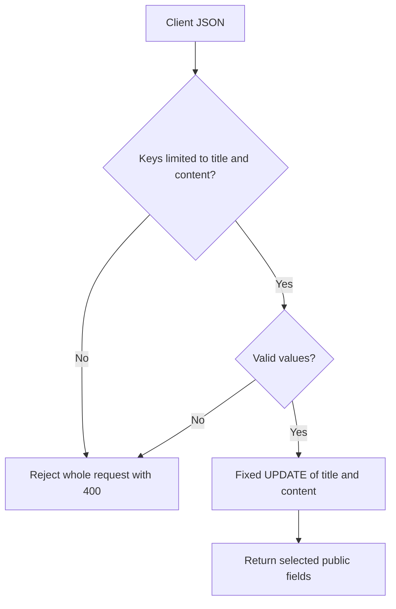

# Exercise 2: Repair API permission failures and mass assignment

**Block 1 · 30 minutes · individual guided investigation**

This is a separate legacy implementation with intentionally vulnerable API routes. The web route already uses the correct policy. Your task is to locate where the API diverges and prove that each repair works. You do not need your Exercise 1 code.

**Suggested time:** predictions and baseline 5 min, permission repairs 10 min, field repair 10 min, tests/evidence 5 min. Use only the provided synthetic accounts in your private Codespace.

## Setup and first run

1. Accept the lecturer's classroom50 assignment and open **your** repository in a GitHub Codespace. Wait for the container setup to finish. It creates the root `.venv` and installs the pinned dependencies.
2. In VS Code's Explorer, right-click **this exercise's folder** and choose **Open in Integrated Terminal**. This avoids accidentally running a different `app.py`.
3. Check the interpreter and install the local dependency list if setup was interrupted:

   ```bash
   python --version
   python -m pip install -r requirements.txt
   ```

   The version must begin `Python 3.14`. If it does not, rebuild the supplied container and select the repository's `.venv/bin/python` interpreter. Do not silently continue on a different Python version.
4. Run the browser application:

   ```bash
   python app.py
   ```

5. Open the forwarded port **5000** from the Ports panel. Confirm its visibility is **Private**. Sign in using the account table below. The browser URL ends with `.app.github.dev` in Codespaces.
6. Use a second terminal in this same exercise folder for tests and API examples. Stop the server with **Ctrl+C** before changing exercises. Because the reloader is disabled, stop and restart after editing Python code.

The API probe does **not** need the browser server. Every `python lab_client.py ...` command starts with a fresh temporary database. Repeated requests within one `--repeat` command share one application and rate-limit budget. A separate command resets them. Browser requests use the separate persistent `instance/notes.sqlite` database.

Reset the browser data only when needed (this removes this exercise's local note edits):

```bash
python -m flask --app app:create_app reset-db
```

For local use outside Codespaces, install Python 3.14, create a virtual environment with `python3.14 -m venv .venv`, activate it (`source .venv/bin/activate` on Linux/macOS, `.venv\Scripts\Activate.ps1` on PowerShell), and install `requirements.txt`. Open `http://127.0.0.1:5000`. Each exercise can run on its own with its own supplied requirements.

## Scenario and policy

Private Notes is a small internal planning application. A Jinja web page and a JSON API access the same SQLite records. The two interfaces must implement the same policy.

| Username | Role | Own note | Read own note | Edit own note | Access another owner's note |
|---|---|---:|---|---|---|
| `reader` | `viewer` | 1 | Yes | No | No |
| `editor` | `editor` | 2 | Yes | Yes | No |
| `other_editor` | `editor` | 3 | Yes | Yes | No |
| `admin` | `admin` | 4 | Yes | Yes | No |

All four fictional accounts use `Classroom-Only-314!`. Do not reuse this password elsewhere. Unknown roles receive no permission. In this deliberately narrow policy, **admin does not override ownership**. No interface permits changing `owner_id` or `is_reviewed`. A role permission answers “may this user perform this operation?” Ownership answers “on this record?”

Roles are reloaded from the database for each request. Client JSON cannot assign a role. The session cookie holds the user ID and CSRF token and is signed, not encrypted. It must not contain a password or private note.

## How the supplied application works

| File or folder | Purpose | How to read it |
|---|---|---|
| `app.py` | Configuration, web routes, API routes, error handlers | Read `create_app()` from top to bottom. A factory is just a function that builds and returns an application. |
| `db.py` | SQLite schema, seed data and query functions | `find_note(id)` returns a row or `None`. `update_note` changes only title/content using SQL placeholders. |
| `security.py` | Role, ownership, CSRF and validation helpers | Functions return a Boolean, return validated data, or stop the request with `abort`. |
| `templates/` | Login and notes pages | Jinja inserts values with `{{ ... }}` and controls loops/conditions with ``. HTML text is escaped automatically. |
| `static/style.css` | Small stylesheet | Kept outside the HTML so the supplied CSP permits it. No JavaScript is required. |
| `lab_client.py` | Repeatable HTTP examples without a running server | Logs in through the real login route and supplies the resulting CSRF token. |
| `tests/` | Checks using Flask's test client | Each test uses a fresh temporary database. Tests never change browser data. |
| `instance/` | Browser application's generated database | Created when you run the app. Ignored by Git. |

`@app.get(...)` registers the function beneath it as a route. `<int:note_id>` converts a URL segment to an integer argument. `g.user` is the user loaded for this request. `session` persists small signed values across requests. `jsonify` creates a JSON response with the correct content type. `return response, 403` sets an HTTP status; returning an error message alone can accidentally send `200`.

A SQLite row supports `note["title"]` like a dictionary, but is not itself a JSON response. `public_note` deliberately selects the response fields. The `?` in SQL is a value placeholder: the SQLite driver binds supplied values instead of constructing SQL by concatenation.

## 1. Establish the intended result before running a request

Create a before/after table in `evidence.md`. Fill in the “should happen” column first.

| Case | Command | Should happen |
|---|---|---|
| Operation permission | `python lab_client.py --user reader --method PATCH --path /api/notes/1 --json '{"title":"Changed"}' --inspect 1` | Viewer denied, title unchanged |
| Protected property | `python lab_client.py --method PATCH --json '{"is_reviewed":1}' --inspect 2` | Entire request rejected, review flag remains 0 |
| Object scope | `python lab_client.py --path /api/notes/3` | Inaccessible record gets 404 |
| Mixed update | `python lab_client.py --method PATCH --json '{"title":"Sneaky","owner_id":3}' --inspect 2` | Neither title nor ownership changes |

Run the commands. In the starter these four requests incorrectly return `200`. Each invocation resets its temporary data. `--inspect` reads the synthetic row directly after the request, so it can show a protected field that the JSON response correctly omits.

Run `python -m pytest -q` and keep the result. These are real failing assertions, not expected-failure markers. A safe starter test may already pass while other controls are broken.

## 2. Repair operation and object permissions

Open `app.py`, compare `edit_note_web` with `patch_note_api`, and find the `FLAW` comments.

Immediately after `check_csrf()` in PATCH, add:

```python
if not can_edit_notes(user):
    abort(403)
```

In **both** GET and PATCH, replace `if note is None:` with:

```python
if not owns_note(user, note):
    abort(404)
```

`note is None` answers whether a record exists; it says nothing about its owner. The shared helper also rejects missing rows. Retest the viewer case and the object-scope case. Expected: `403` and `404`. Field attacks on the editor's own note still succeed until Part 3. Explain why that result does not mean your role/ownership repairs failed.

## 3. Replace unsafe field assignment

Look at `values = dict(note)` and `values.update(data)`. The second line merges client keys into the record. Even parameterised SQL cannot decide whether a user has permission to change a particular field. The fixed SQL in `legacy_update` avoids introducing SQL injection into this exercise, but its field permissions remain unsafe.

In PATCH, replace the entire section from `data = read_json_object()` down to its `return jsonify(...)` with:

```python
data = validate_changes(read_json_object())
title = data.get("title", note["title"])
content = data.get("content", note["content"])
update_note(note_id, user["id"], title, content)
return jsonify(public_note(find_note(note_id)))
```

Leave the authentication, CSRF, role and ownership checks above it. The allowlist rejects `owner_id`, `is_reviewed`, `role` and any other unexpected key. The database update specifies only two writable columns. Keeping both controls makes the policy explicit at two points.

Retest all four cases and run:

```bash
python -m pytest -q
```

**Checkpoint:** viewer `403`; protected/mixed bodies `400`; other owner's GET `404`. The stored rows remain unchanged after denials. All supplied tests pass, and an editor's valid own-note update still works.



## 4. Explain the repaired boundaries

Match each defect to a category: missing operation permission (OWASP API5:2023, broken function-level authorisation), missing ownership (API1:2023, broken object-level authorisation), and writable protected properties (API3:2023, broken object-property-level authorisation). Excessive response fields can also fall under API3, so inspect `public_note` as well.

Use a claim, evidence and limitation structure: “The allowlist rejects the protected property. The mixed-body test returns 400 and the stored title/owner are unchanged. New routes still require review because they may bypass this helper.”

**Extension:** add a test for `{"content":"legitimate","is_reviewed":1}` and check that neither field changes. Discuss rejecting unknown fields versus silently ignoring them, including client mistakes and observability.

**Completion:** a before/after table, passing tests, and one paragraph explaining why parameterised SQL does not solve mass assignment. Full reference: `solutions/exercise-2/`.

## Reading a test

`pytest` finds functions whose names start with `test_`. A fixture supplies prepared objects such as `client` (a pretend browser) and `login` (a helper that performs the real login). `assert actual == expected` fails if the claim is false. A parameterised test repeats one check with several inputs.

```python
def test_patch_viewer_denied(client, login):
    token = login("reader")  # Arrange a viewer and a valid request token.
    response = client.patch(
        "/api/notes/1",
        json={"title": "Changed"},
        headers={"X-CSRF-Token": token},
    )  # Act: viewer attempts to edit their OWN record.
    assert response.status_code == 403  # Assert: role permission blocks it.
```

Using the viewer's own note isolates the **role** check. Using a valid CSRF token prevents a different defence from hiding a missing role check. Strong security tests check both the response and the unchanged database where relevant. A passing suite provides evidence for the tested cases; it does not prove the whole system secure.

## Troubleshooting and working independently

- **`501` from Exercise 1:** the endpoint still contains its intentional `abort(501)` placeholder. Replace the whole matching function, including its body.
- **`403` while testing another control:** check the account role and CSRF header. `lab_client.py` supplies a valid token unless you ask for `--no-csrf`. Tests use valid prerequisites when testing ownership or validation.
- **`404` for an existing record:** this is the intended response for another owner's record. `999` is a missing ID and also returns `404`.
- **`415`:** the API expects a JSON content type. Use `--json` for normal examples, or deliberately use `--raw` to test malformed bodies.
- **`ModuleNotFoundError`:** verify the interpreter and run `python -m pip install -r requirements.txt` in the selected environment.
- **Port already in use / wrong application:** stop the previous `python app.py` with Ctrl+C. Check `pwd`, open a new terminal in this exercise folder, and restart. Browser cookies from another exercise may require signing in again.
- **Changes seem to disappear:** the probe and tests use temporary databases. For persistence use the browser, or `--inspect NOTE_ID` to inspect the same probe's database after its request.
- **Syntax/indentation error:** Python uses indentation for blocks. Functions inside `create_app` have four spaces, their bodies eight. In VS Code, undo the last paste and match the neighbouring route.
- **A test fails:** read the failing test name, then the `assert` and the actual value. Run just that test with `python -m pytest -q tests/test_api.py -k NAME`. A failed security assertion is different from an import or syntax error.

Work solo through the same predict, run, explain and repair sequence. Keep a small evidence record using `evidence.md`. If stuck, read the relevant completed function under the root `solutions/` directory, explain each line, and then implement it in your starter. You can run a solution independently. No earlier exercise is a prerequisite.

## Further reading

- [Flask quickstart](https://flask.palletsprojects.com/en/stable/quickstart/) for routes, responses and sessions.
- [Flask testing](https://flask.palletsprojects.com/en/stable/testing/) for test clients and fixtures.
- [OWASP API Security Top 10, 2023 edition](https://api-security.owasp.org/editions/2023/en/0x11-t10/) for API risk categories.
- [Flask security considerations](https://flask.palletsprojects.com/en/stable/web-security/) and [error handlers](https://flask.palletsprojects.com/en/stable/errorhandling/).
- [OWASP Logging Cheat Sheet](https://cheatsheetseries.owasp.org/cheatsheets/Logging_Cheat_Sheet.html).
- [Flask-Limiter documentation](https://flask-limiter.readthedocs.io/en/stable/) for limit configuration and storage.

The concrete accounts, policy, code and request examples in this pack are teaching examples. References checked 17 November 2026.
