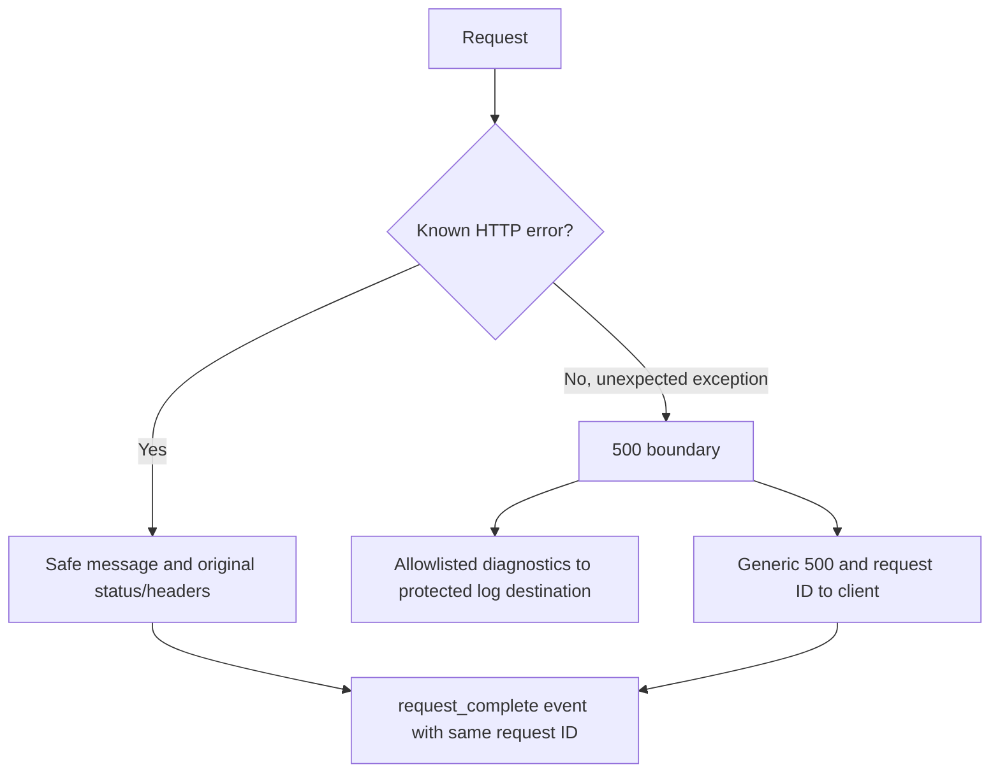

# Exercise 3: Safe error responses and structured logging

**Block 2 · 45 minutes · guided then partially independent**

This independent starter already has the complete protected API. Its **error reporting** is deliberately inadequate: HTTP errors use default HTML responses, and the unexpected-error handler exposes exception text. Logging has a placeholder. You will implement a safe boundary between client messages and diagnostic records.

**Suggested time:** observe 5 min, HTTP handler 10 min, logging 15 min, unexpected handler/tests 10 min, evidence 5 min. Complete the Block 2 disclosure worksheet first if studying independently.

## Setup and first run

1. Accept the lecturer's classroom50 assignment and open **your** repository in a GitHub Codespace. Wait for the container setup to finish. It creates the root `.venv` and installs the pinned dependencies.
2. In VS Code's Explorer, right-click **this exercise's folder** and choose **Open in Integrated Terminal**. This avoids accidentally running a different `app.py`.
3. Check the interpreter and install the local dependency list if setup was interrupted:

   ```bash
   python --version
   python -m pip install -r requirements.txt
   ```

   The version must begin `Python 3.14`. If it does not, rebuild the supplied container and select the repository's `.venv/bin/python` interpreter. Do not silently continue on a different Python version.
4. Run the browser application:

   ```bash
   python app.py
   ```

5. Open the forwarded port **5000** from the Ports panel. Confirm its visibility is **Private**. Sign in using the account table below. The browser URL ends with `.app.github.dev` in Codespaces.
6. Use a second terminal in this same exercise folder for tests and API examples. Stop the server with **Ctrl+C** before changing exercises. Because the reloader is disabled, stop and restart after editing Python code.

The API probe does **not** need the browser server. Every `python lab_client.py ...` command starts with a fresh temporary database. Repeated requests within one `--repeat` command share one application and rate-limit budget. A separate command resets them. Browser requests use the separate persistent `instance/notes.sqlite` database.

Reset the browser data only when needed (this removes this exercise's local note edits):

```bash
python -m flask --app app:create_app reset-db
```

For local use outside Codespaces, install Python 3.14, create a virtual environment with `python3.14 -m venv .venv`, activate it (`source .venv/bin/activate` on Linux/macOS, `.venv\Scripts\Activate.ps1` on PowerShell), and install `requirements.txt`. Open `http://127.0.0.1:5000`. Each exercise can run on its own with its own supplied requirements.

## Scenario and policy

Private Notes is a small internal planning application. A Jinja web page and a JSON API access the same SQLite records. The two interfaces must implement the same policy.

| Username | Role | Own note | Read own note | Edit own note | Access another owner's note |
|---|---|---:|---|---|---|
| `reader` | `viewer` | 1 | Yes | No | No |
| `editor` | `editor` | 2 | Yes | Yes | No |
| `other_editor` | `editor` | 3 | Yes | Yes | No |
| `admin` | `admin` | 4 | Yes | Yes | No |

All four fictional accounts use `Classroom-Only-314!`. Do not reuse this password elsewhere. Unknown roles receive no permission. In this deliberately narrow policy, **admin does not override ownership**. No interface permits changing `owner_id` or `is_reviewed`. A role permission answers “may this user perform this operation?” Ownership answers “on this record?”

Roles are reloaded from the database for each request. Client JSON cannot assign a role. The session cookie holds the user ID and CSRF token and is signed, not encrypted. It must not contain a password or private note.

## How the supplied application works

| File or folder | Purpose | How to read it |
|---|---|---|
| `app.py` | Configuration, web routes, API routes, error handlers | Read `create_app()` from top to bottom. A factory is just a function that builds and returns an application. |
| `db.py` | SQLite schema, seed data and query functions | `find_note(id)` returns a row or `None`. `update_note` changes only title/content using SQL placeholders. |
| `security.py` | Role, ownership, CSRF and validation helpers | Functions return a Boolean, return validated data, or stop the request with `abort`. |
| `templates/` | Login and notes pages | Jinja inserts values with `{{ ... }}` and controls loops/conditions with ``. HTML text is escaped automatically. |
| `static/style.css` | Small stylesheet | Kept outside the HTML so the supplied CSP permits it. No JavaScript is required. |
| `lab_client.py` | Repeatable HTTP examples without a running server | Logs in through the real login route and supplies the resulting CSRF token. |
| `tests/` | Checks using Flask's test client | Each test uses a fresh temporary database. Tests never change browser data. |
| `instance/` | Browser application's generated database | Created when you run the app. Ignored by Git. |

`@app.get(...)` registers the function beneath it as a route. `<int:note_id>` converts a URL segment to an integer argument. `g.user` is the user loaded for this request. `session` persists small signed values across requests. `jsonify` creates a JSON response with the correct content type. `return response, 403` sets an HTTP status; returning an error message alone can accidentally send `200`.

A SQLite row supports `note["title"]` like a dictionary, but is not itself a JSON response. `public_note` deliberately selects the response fields. The `?` in SQL is a value placeholder: the SQLite driver binds supplied values instead of constructing SQL by concatenation.

## 1. Observe the problem safely

Run `python lab_client.py --fault`. This enables a special fault route **inside the temporary test application only**. It raises a fixed synthetic exception containing a pretend SQL query, internal path and `SYNTHETIC_SECRET`. The browser application never enables this route.

The starter returns `500`, but its body leaks the exception message. Record the categories of leaked information, not real secrets. Run `python lab_client.py --path /api/missing` and notice that the `404` response is HTML rather than the API's intended JSON error format.

Expected failures: some API checks that inspect the 404 JSON body and all the incomplete error/logging checks. Working access controls still reject invalid requests. `test_method_error_preserves_allow` also detects the HTML response.

## 2. Handle expected HTTP errors

An `HTTPException` represents outcomes such as an invalid request or missing route. It has an HTTP code and may carry useful protocol headers. An unexpected exception such as a database failure is a different case. Never convert every error into a successful `200` response or turn `404` into `500`.

Find `handle_http_error` in `app.py`. Replace its body with:

```python
# Preserve protocol headers such as Allow (405) and Retry-After.
response = error.get_response()
response.data = app.json.dumps({"error": SAFE_MESSAGES.get(error.code, "Request failed."),
                                "request_id": g.request_id})
response.content_type = "application/json"
return response
```

`error.get_response()` provides the existing status and headers. We replace its body and content type, preserving `Allow` on a `405` response and rate-limit information where present. `SAFE_MESSAGES` is supplied at the top of `app.py`; it contains application-controlled wording. A request ID appears in both the response body and `X-Request-ID` header so a support report can be correlated with a server event.

Run `python lab_client.py --path /api/missing`: expect JSON, `404`, “Not found.” and a request ID. Try `python lab_client.py --method DELETE`: expect `405`. Run `python -m pytest -q tests/test_api.py`. The access-control suite should now pass; logging is still incomplete.

## 3. Create an allowlisted JSON log record

Open `security.py` and locate `log_event`. The supplied `configure_logging` already connects a dedicated logger to the terminal. Replace the `log_event` function with this implementation:

```python
def log_event(event, status, error=None):
    # TODO LOG: build an allowlisted record, never dump headers/body/session.
    record = {
        "timestamp": datetime.now(timezone.utc).isoformat(),
        "event": event,
        "status": status,
        "request_id": g.request_id,
        "endpoint": request.endpoint or "unmatched",
    }
    if error is not None:
        record["exception_type"] = type(error).__name__
        # Record the final function/line, without exception text or locals.
        tb = error.__traceback__
        while tb is not None and tb.tb_next is not None:
            tb = tb.tb_next
        if tb is not None:
            record["location"] = f"{tb.tb_frame.f_code.co_name}:{tb.tb_lineno}"
    current_app.extensions["security_logger"].info(json.dumps(record))
```

Read the data flow carefully:

- `event` and `status` are arguments chosen by our application. `datetime.now(timezone.utc)` records an explicit UTC timestamp.
- `g.request_id` was generated by the server at the start of the request. The endpoint is Flask's registered function name, not an arbitrary URL/query string.
- The dictionary is an **allowlist of fields to record**. It excludes the request body, note contents, session cookie, CSRF token, password and Authorization header.
- `type(error).__name__` gives a diagnostic category. The final traceback frame gives the function and line only. We exclude exception text, source-line text, local variables and full paths because they can contain sensitive data.
- `json.dumps` makes one machine-readable JSON record. A log collector could filter by event/status or join entries by request ID. JSON formatting alone does not remove secrets or provide access control.

In `app.py`, find `TODO REQUEST LOG` inside `finish_response`. Replace that comment with:

```python
log_event("request_complete", response.status_code)
```

Keep `return response` as the final line. The after-request function must return the response or Flask cannot send it. This creates request-completion events for success and denial. For a large deployment, review event volume, retention and monitoring instead of recording everything without a plan.

## 4. Handle an unexpected error with less guidance

In `handle_unexpected_error`, replace the unsafe response. Implement these two requirements:

1. Call `log_event` with event `unexpected_error`, status `500`, and the actual exception as its third argument.
2. Return JSON containing `SAFE_MESSAGES[500]` and `g.request_id`, with HTTP status `500`.

Hint: compare the use of `jsonify` in the API routes. The third parameter of `log_event` is optional for normal completion events, but supplies safe diagnostic details for a failure.

<details><summary>Implementation self-check (open after attempting)</summary>

```python
log_event("unexpected_error", 500, error)
return jsonify(error=SAFE_MESSAGES[500], request_id=g.request_id), 500
```

</details>

This broad exception handler is a final response boundary. A separate, more specific HTTPException handler preserves expected HTTP outcomes. Avoid blanket `try/except Exception: pass` around business logic: it would hide defects and could allow the application to continue with incorrect state. Narrow recovery belongs only where the code knows how to recover or roll back. Our handler does not attempt to retry the failed operation.



## 5. Check both the response and the logs

```bash
python lab_client.py --fault
python lab_client.py --path /api/missing
python -m pytest -q
```

**Checkpoint:** the fault returns `500` with `An unexpected error occurred.` and a request ID. JSON log lines include `unexpected_error`, `RuntimeError` and a location such as `lab_fault:123` (line number varies), followed by `request_complete`. Both have the same request ID. Neither body nor logs contain `SYNTHETIC_SECRET`, SQL text or the internal path. A `404` remains `404`.

`tests/test_errors.py` captures the dedicated logger into a string. Canary values in headers, query parameters and note contents verify that these are absent from logs. These tests are intentionally stronger than searching for the words “password” or “token”: real sensitive values may have other names.

**Independent task:** add a test that a valid-CSRF malformed JSON PATCH returns `400`, uses a generic JSON error, and produces a `request_complete` event with status 400. Adapt the 404 test and explain why this does not need an `unexpected_error` event.

**Evaluation:** what diagnostic value is lost by omitting exception messages? Propose a restricted diagnostic workflow, redaction policy and retention/access rules. Consider logging system failures, disk exhaustion and alert fatigue. This exercise checks the application logger; reverse proxies and hosting access logs require their own configuration.

**Completion:** safe HTTP/unexpected handlers, safe structured logs, passing tests and a correlated response/log example. Reference: `solutions/exercise-3/`.

## Reading a test

`pytest` finds functions whose names start with `test_`. A fixture supplies prepared objects such as `client` (a pretend browser) and `login` (a helper that performs the real login). `assert actual == expected` fails if the claim is false. A parameterised test repeats one check with several inputs.

```python
def test_patch_viewer_denied(client, login):
    token = login("reader")  # Arrange a viewer and a valid request token.
    response = client.patch(
        "/api/notes/1",
        json={"title": "Changed"},
        headers={"X-CSRF-Token": token},
    )  # Act: viewer attempts to edit their OWN record.
    assert response.status_code == 403  # Assert: role permission blocks it.
```

Using the viewer's own note isolates the **role** check. Using a valid CSRF token prevents a different defence from hiding a missing role check. Strong security tests check both the response and the unchanged database where relevant. A passing suite provides evidence for the tested cases; it does not prove the whole system secure.

## Troubleshooting and working independently

- **`501` from Exercise 1:** the endpoint still contains its intentional `abort(501)` placeholder. Replace the whole matching function, including its body.
- **`403` while testing another control:** check the account role and CSRF header. `lab_client.py` supplies a valid token unless you ask for `--no-csrf`. Tests use valid prerequisites when testing ownership or validation.
- **`404` for an existing record:** this is the intended response for another owner's record. `999` is a missing ID and also returns `404`.
- **`415`:** the API expects a JSON content type. Use `--json` for normal examples, or deliberately use `--raw` to test malformed bodies.
- **`ModuleNotFoundError`:** verify the interpreter and run `python -m pip install -r requirements.txt` in the selected environment.
- **Port already in use / wrong application:** stop the previous `python app.py` with Ctrl+C. Check `pwd`, open a new terminal in this exercise folder, and restart. Browser cookies from another exercise may require signing in again.
- **Changes seem to disappear:** the probe and tests use temporary databases. For persistence use the browser, or `--inspect NOTE_ID` to inspect the same probe's database after its request.
- **Syntax/indentation error:** Python uses indentation for blocks. Functions inside `create_app` have four spaces, their bodies eight. In VS Code, undo the last paste and match the neighbouring route.
- **A test fails:** read the failing test name, then the `assert` and the actual value. Run just that test with `python -m pytest -q tests/test_api.py -k NAME`. A failed security assertion is different from an import or syntax error.

Work solo through the same predict, run, explain and repair sequence. Keep a small evidence record using `evidence.md`. If stuck, read the relevant completed function under the root `solutions/` directory, explain each line, and then implement it in your starter. You can run a solution independently. No earlier exercise is a prerequisite.

## Further reading

- [Flask quickstart](https://flask.palletsprojects.com/en/stable/quickstart/) for routes, responses and sessions.
- [Flask testing](https://flask.palletsprojects.com/en/stable/testing/) for test clients and fixtures.
- [OWASP API Security Top 10, 2023 edition](https://api-security.owasp.org/editions/2023/en/0x11-t10/) for API risk categories.
- [Flask security considerations](https://flask.palletsprojects.com/en/stable/web-security/) and [error handlers](https://flask.palletsprojects.com/en/stable/errorhandling/).
- [OWASP Logging Cheat Sheet](https://cheatsheetseries.owasp.org/cheatsheets/Logging_Cheat_Sheet.html).
- [Flask-Limiter documentation](https://flask-limiter.readthedocs.io/en/stable/) for limit configuration and storage.

The concrete accounts, policy, code and request examples in this pack are teaching examples. References checked 17 November 2026.
