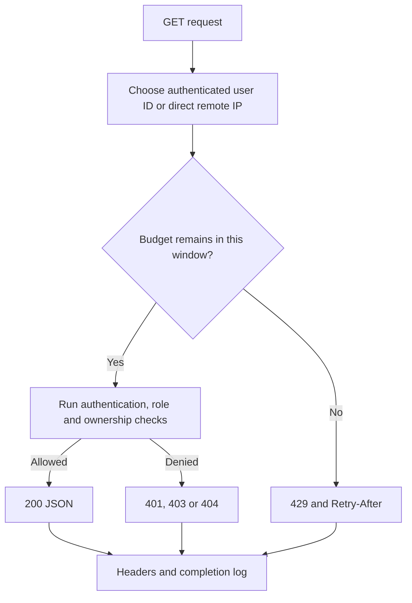

# Exercise 4: Application hardening and rate limiting

**Block 2 · 30 minutes · partially independent**

This separate starter includes completed API controls, safe errors and structured logging. Flask-Limiter is installed and initialised, but no route limit is attached. Your code tasks are a response header policy and one rate-limit decorator. Defensive configuration is supplied for review.

**Suggested time:** baseline 5 min, headers 10 min, rate limit 10 min, configuration and evidence 5 min. No earlier exercise is required.

## Setup and first run

1. Accept the lecturer's classroom50 assignment and open **your** repository in a GitHub Codespace. Wait for the container setup to finish. It creates the root `.venv` and installs the pinned dependencies.
2. In VS Code's Explorer, right-click **this exercise's folder** and choose **Open in Integrated Terminal**. This avoids accidentally running a different `app.py`.
3. Check the interpreter and install the local dependency list if setup was interrupted:

   ```bash
   python --version
   python -m pip install -r requirements.txt
   ```

   The version must begin `Python 3.14`. If it does not, rebuild the supplied container and select the repository's `.venv/bin/python` interpreter. Do not silently continue on a different Python version.
4. Run the browser application:

   ```bash
   python app.py
   ```

5. Open the forwarded port **5000** from the Ports panel. Confirm its visibility is **Private**. Sign in using the account table below. The browser URL ends with `.app.github.dev` in Codespaces.
6. Use a second terminal in this same exercise folder for tests and API examples. Stop the server with **Ctrl+C** before changing exercises. Because the reloader is disabled, stop and restart after editing Python code.

The API probe does **not** need the browser server. Every `python lab_client.py ...` command starts with a fresh temporary database. Repeated requests within one `--repeat` command share one application and rate-limit budget. A separate command resets them. Browser requests use the separate persistent `instance/notes.sqlite` database.

Reset the browser data only when needed (this removes this exercise's local note edits):

```bash
python -m flask --app app:create_app reset-db
```

For local use outside Codespaces, install Python 3.14, create a virtual environment with `python3.14 -m venv .venv`, activate it (`source .venv/bin/activate` on Linux/macOS, `.venv\Scripts\Activate.ps1` on PowerShell), and install `requirements.txt`. Open `http://127.0.0.1:5000`. Each exercise can run on its own with its own supplied requirements.

## Scenario and policy

Private Notes is a small internal planning application. A Jinja web page and a JSON API access the same SQLite records. The two interfaces must implement the same policy.

| Username | Role | Own note | Read own note | Edit own note | Access another owner's note |
|---|---|---:|---|---|---|
| `reader` | `viewer` | 1 | Yes | No | No |
| `editor` | `editor` | 2 | Yes | Yes | No |
| `other_editor` | `editor` | 3 | Yes | Yes | No |
| `admin` | `admin` | 4 | Yes | Yes | No |

All four fictional accounts use `Classroom-Only-314!`. Do not reuse this password elsewhere. Unknown roles receive no permission. In this deliberately narrow policy, **admin does not override ownership**. No interface permits changing `owner_id` or `is_reviewed`. A role permission answers “may this user perform this operation?” Ownership answers “on this record?”

Roles are reloaded from the database for each request. Client JSON cannot assign a role. The session cookie holds the user ID and CSRF token and is signed, not encrypted. It must not contain a password or private note.

## How the supplied application works

| File or folder | Purpose | How to read it |
|---|---|---|
| `app.py` | Configuration, web routes, API routes, error handlers | Read `create_app()` from top to bottom. A factory is just a function that builds and returns an application. |
| `db.py` | SQLite schema, seed data and query functions | `find_note(id)` returns a row or `None`. `update_note` changes only title/content using SQL placeholders. |
| `security.py` | Role, ownership, CSRF and validation helpers | Functions return a Boolean, return validated data, or stop the request with `abort`. |
| `templates/` | Login and notes pages | Jinja inserts values with `{{ ... }}` and controls loops/conditions with ``. HTML text is escaped automatically. |
| `static/style.css` | Small stylesheet | Kept outside the HTML so the supplied CSP permits it. No JavaScript is required. |
| `lab_client.py` | Repeatable HTTP examples without a running server | Logs in through the real login route and supplies the resulting CSRF token. |
| `tests/` | Checks using Flask's test client | Each test uses a fresh temporary database. Tests never change browser data. |
| `instance/` | Browser application's generated database | Created when you run the app. Ignored by Git. |

`@app.get(...)` registers the function beneath it as a route. `<int:note_id>` converts a URL segment to an integer argument. `g.user` is the user loaded for this request. `session` persists small signed values across requests. `jsonify` creates a JSON response with the correct content type. `return response, 403` sets an HTTP status; returning an error message alone can accidentally send `200`.

A SQLite row supports `note["title"]` like a dictionary, but is not itself a JSON response. `public_note` deliberately selects the response fields. The `?` in SQL is a value placeholder: the SQLite driver binds supplied values instead of constructing SQL by concatenation.

## 1. Inspect the baseline

Run `python lab_client.py`. Identify its response status, JSON content type and request ID. It already supplies `Cache-Control: no-store`, but the three headers below are absent. Run `python -m pytest -q tests/test_hardening.py`: some checks fail because the exercise is unfinished.

## 2. Add the supplied browser policy

Open `app.py`, find `finish_response` and the `TODO HEADERS` comment. Add the following before the logging call and `return response`:

```python
# TODO HEADERS: browser defences also belong on error responses.
response.headers["X-Content-Type-Options"] = "nosniff"
response.headers["Referrer-Policy"] = "no-referrer"
response.headers["Content-Security-Policy"] = (
    "default-src 'self'; script-src 'none'; style-src 'self'; "
    "object-src 'none'; base-uri 'none'; frame-ancestors 'none'; form-action 'self'"
)
```

| Header | Effect in this application | Limit |
|---|---|---|
| `X-Content-Type-Options: nosniff` | Instructs browsers to respect declared MIME types in relevant contexts | Does not validate JSON fields or grant permissions |
| `Referrer-Policy: no-referrer` | Stops the browser sending a Referer header from these pages | Does not remove data already placed in a URL or logs |
| `Content-Security-Policy` | Restricts resources, forms and embedding for HTML pages | Depends on browser enforcement and a policy compatible with the application |

Read the CSP directives: `default-src 'self'` supplies a default for resource types; `script-src 'none'` forbids scripts; `style-src 'self'` allows our external stylesheet; `object-src 'none'` blocks plugins; `base-uri 'none'` blocks base-URL changes; `frame-ancestors 'none'` prevents embedding; `form-action 'self'` keeps form submissions on the same origin. The app has no inline JavaScript or styles. These policies are examples chosen for this small application, not a universal CSP to paste into every site.

Restart the browser server. Log in, edit your own note and sign out. Inspect a page in browser developer tools, **Network → response headers**, and confirm that the controls appear. If embedding is blocked by a preview, open the forwarded URL in its own browser tab. Use `python lab_client.py --path /api/missing` to verify headers on errors as well as success.

## 3. Attach a route-specific rate limit

At the top of `create_app`, read the supplied `rate_limit_key` function and `Limiter` setup. Authenticated requests use the database user ID. Anonymous requests use `request.remote_addr`; we do not trust a caller's `X-Forwarded-For` header. The request setup runs before the limiter so `g.user` is available.

Find `get_note_api`. Put this line between its route decorator and `def`:

```python
@app.get("/api/notes/<int:note_id>")
@limiter.limit("5 per minute")
def get_note_api(note_id):
    # Keep the existing function body unchanged.
```

All these lines remain indented inside `create_app`. The route decorator registers the wrapped function. In this example the budget covers this GET endpoint per identity, across note IDs; it is not a separate budget per note. POST/PATCH and login are outside this **demonstration** limit. Failed GETs can also consume this route's budget.

```bash
python lab_client.py --repeat 6
python -m pytest -q tests/test_hardening.py
python -m pytest -q
```

**Checkpoint:** requests 1–5 return `200`, request 6 returns `429`, a safe JSON body and `Retry-After`. The limit applies before route work. A new probe command starts a fresh budget. In a running browser app, wait for the fixed window to expire or restart the server for a fresh local demonstration. Retrying continuously while limited is poor client behaviour.



## 4. Review defensive settings and limits

| Setting or decision | Supplied behaviour | Deployment reasoning |
|---|---|---|
| Debugger | `DEBUG=False`, no interactive reloader/debugger | A debugger can expose code execution and internals |
| Secret key | Environment variable or fresh random development key | Restarts invalidate development sessions. Production needs a stable protected secret and rotation plan |
| Session cookie | HttpOnly, SameSite=Lax | Helpful cookie controls; state-changing routes still require CSRF |
| Secure cookie | True when Codespaces sets `CODESPACES`, false for local HTTP | Production HTTPS must explicitly use Secure. Secure cookies do not travel over ordinary HTTP |
| Request body size | 16 KiB maximum | Bounds accepted body size; also consider timeouts/concurrency and upstream limits |
| HSTS | Not added in this lab | Enable deliberately for the application's own HTTPS deployment; do not assume ownership of a shared development domain |
| Rate storage | `memory://` in one process | Restart loses counters. Multiple workers have separate state; shared production storage is required |
| Proxy addresses | No automatic trust of forwarded headers | A production proxy arrangement needs a precise trust configuration |

Rate limits reduce resource abuse but do not prevent all denial-of-service attacks. Account-based limits can be evaded by multiple accounts; IP limits can penalise shared networks and can be bypassed by distributed clients. Fixed windows permit boundary bursts. Production designs need coordinated limits, observability, endpoint-specific costs and a plan for storage outages. Login throttling is a separate control to design, not something this one GET decorator has solved.

**Independent task:** explain why the test `test_budget_separate_by_authenticated_user` uses two separate clients. Propose a case involving an expensive PATCH endpoint and identify the key, window, budget and a false-positive risk. Keep the supplied GET contract unchanged so the tests remain comparable.

**Completion:** header checks and all tests passing, evidence of a sixth request receiving 429, a configuration review, and one limitation with a proposed improvement.

## Troubleshooting and working independently

- **`501` from Exercise 1:** the endpoint still contains its intentional `abort(501)` placeholder. Replace the whole matching function, including its body.
- **`403` while testing another control:** check the account role and CSRF header. `lab_client.py` supplies a valid token unless you ask for `--no-csrf`. Tests use valid prerequisites when testing ownership or validation.
- **`404` for an existing record:** this is the intended response for another owner's record. `999` is a missing ID and also returns `404`.
- **`415`:** the API expects a JSON content type. Use `--json` for normal examples, or deliberately use `--raw` to test malformed bodies.
- **`ModuleNotFoundError`:** verify the interpreter and run `python -m pip install -r requirements.txt` in the selected environment.
- **Port already in use / wrong application:** stop the previous `python app.py` with Ctrl+C. Check `pwd`, open a new terminal in this exercise folder, and restart. Browser cookies from another exercise may require signing in again.
- **Changes seem to disappear:** the probe and tests use temporary databases. For persistence use the browser, or `--inspect NOTE_ID` to inspect the same probe's database after its request.
- **Syntax/indentation error:** Python uses indentation for blocks. Functions inside `create_app` have four spaces, their bodies eight. In VS Code, undo the last paste and match the neighbouring route.
- **A test fails:** read the failing test name, then the `assert` and the actual value. Run just that test with `python -m pytest -q tests/test_api.py -k NAME`. A failed security assertion is different from an import or syntax error.

Work solo through the same predict, run, explain and repair sequence. Keep a small evidence record using `evidence.md`. If stuck, use the failing test and troubleshooting steps to isolate the control, inspect the relevant starter function, and record any unresolved questions in your evidence. No earlier exercise is a prerequisite.

## Further reading

- [Flask quickstart](https://flask.palletsprojects.com/en/stable/quickstart/) for routes, responses and sessions.
- [Flask testing](https://flask.palletsprojects.com/en/stable/testing/) for test clients and fixtures.
- [OWASP API Security Top 10, 2023 edition](https://api-security.owasp.org/editions/2023/en/0x11-t10/) for API risk categories.
- [Flask security considerations](https://flask.palletsprojects.com/en/stable/web-security/) and [error handlers](https://flask.palletsprojects.com/en/stable/errorhandling/).
- [OWASP Logging Cheat Sheet](https://cheatsheetseries.owasp.org/cheatsheets/Logging_Cheat_Sheet.html).
- [Flask-Limiter documentation](https://flask-limiter.readthedocs.io/en/stable/) for limit configuration and storage.

The concrete accounts, policy, code and request examples in this pack are teaching examples. References checked 17 November 2026.
